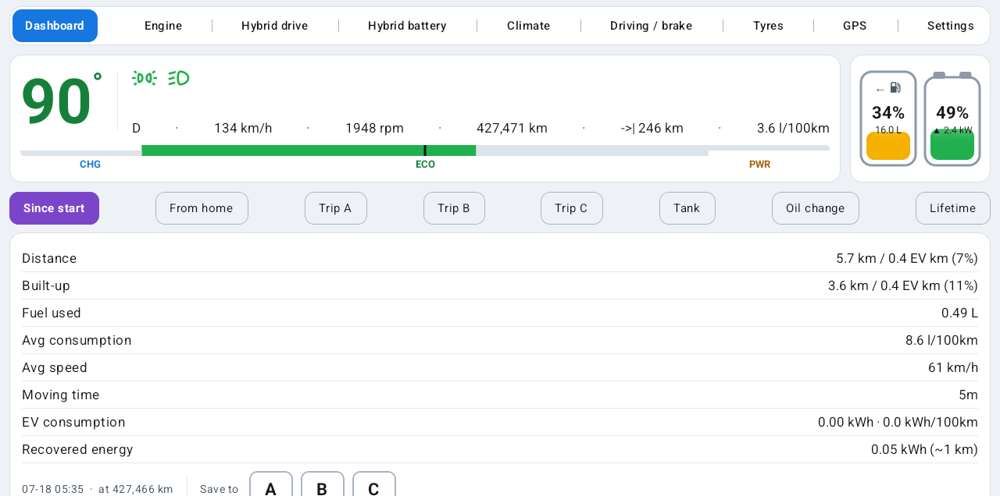
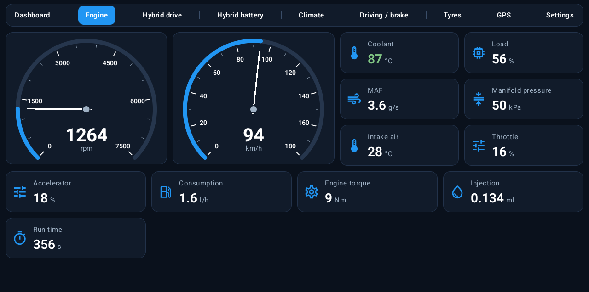
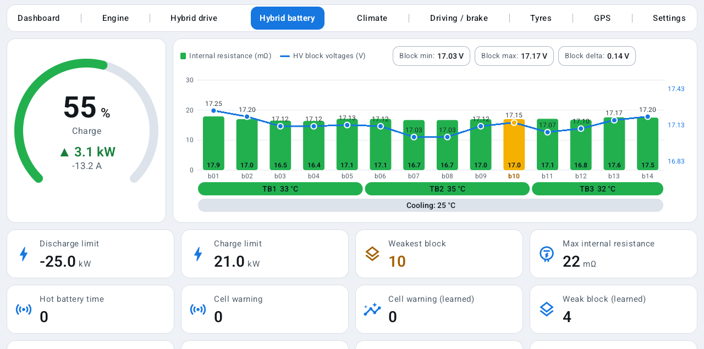
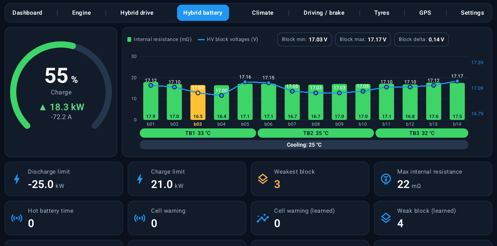

# PriusCAN

Full CAN/OBD telemetry & diagnostics for the **Toyota Prius Gen3 (XW30 / ZVW30)**.

| | |
|---|---|
|  |  |
|  |  |

*Dashboard · engine dials · HV battery (per-block internal resistance as bars, block voltage as
the line, temperature bands, fan bar). Taken on an emulator replaying a logged drive; the night
theme follows the car's ambient-light sensor.*

* **Firmware** — ESP32-C3 + SN65HVD230, ESPHome (`prius_can_full_v2.yaml` +
  `prius_parse.h`). Polls four diagnostic ECUs over ISO-TP (engine `7E0`, hybrid
  `7E2`, A/C `7C4`, skid/ABS `7B0`) and decodes many passive broadcast frames;
  emits one JSON line (~120 signals) every ~250 ms on USB serial. Trip data +
  battery-health history persist in NVS. A whitelisted **read-only diagnostic probe**
  (`X<reqid> <hex bytes>`) lets the host query other ECUs, e.g. the airbag ECU's stored codes. `prius_parse.h` is pure, ESPHome-free
  C++ (host-testable with `g++`); the YAML bridges it to ESPHome.
* **Android app** (`app/`) — Kotlin + Compose head-unit app:
  * **Dashboard** — coolant temp, calibrated virtual **fuel gauge** (consumption-
    driven litres, immune to the bouncy sender) + **range / distance-to-empty**,
    SoC gauge with pack power, odometer row (gear · speed · rpm · odo · range ·
    l/100km, or the pack draw in EV mode), the **HSI energy-flow strip** (CHG / ECO /
    PWR), status icons, a **bullseye level** (pitch / roll from the G sensor) and a
    top-down door-open overlay.
  * **Tabs** — engine (animated rpm + speed dials), hybrid drive (MG1/MG2, inverters),
    HV battery (one chart for the 14 blocks: internal resistance + voltage, temperature
    bands, fan, learned capacity / SOH), climate, drive/brake, TPMS, GPS, settings.
  * **Night and day themes**, switched by the car's ambient-light sensor.
  * **Trip computer** — 8 trip slots (since-boot / lifetime / tank / oil / A / B /
    C / from-home), refuel & oil-change history, recovered-energy / regen.
  * A draggable always-on **status overlay** (the head-unit ROM hides third-party
    notification icons), audible/visual warnings, **Home Assistant** MQTT push
    with an offline buffer, and a second serial device for **TPMS**.
  * **Reverse camera** — feeds the head unit's camera app with the steering angle
    for live trajectory lines (needs the `canstub/` module on the head unit).
  * **Fully multilingual** — every UI string is a localized resource (en + hu, de,
    fr, es, it, pt, nl, pl).
  * **App-driven firmware update** — the matching firmware `.bin` is bundled in
    the APK and flashed to the ESP over the USB serial link from the app (no
    separate flashing tool needed). The app itself updates from the GitHub release
    (`tools/release.sh` publishes it).
* **`render/`** — Blender script (`render_combos.py`) + source model
  (`prius.glb`) that bakes the 32 door-state PNGs into `app/src/main/assets`.

Signals come from the canonical PriusChat GenIII Torque CSV; some (MG rpm/torque,
inverter temp, HV voltages, the HSI dial) were reverse-engineered from broadcast
frames and moved off the poll for faster updates + freed bus bandwidth.

## Docs
* **`DEVELOPER_GUIDE.md`** — architecture, wiring, every source file, JSON
  schema, calibration status, open tasks. **Start here.**
* **`BATTERY_HEALTH.md`** — HV battery diagnostics, capacity/SOH estimation,
  weak-block detection.
* **`TPMS_PROTOCOL.md`** / **`TPMS_APP_INTEGRATION.md`** — the tyre-pressure sensor.
* **`CLAUDE.md`** — operational brief + hard rules for Claude Code CLI.

## Quick start
**Firmware** (the assistant compiles + bundles the `.bin`; you OTA from the app):
put `prius_can_full_v2.yaml` and `prius_parse.h` in the same dir, then
`esphome compile prius_can_full_v2.yaml`. Host-test the pure logic with
`g++ -std=gnu++17 -I. <test>.cpp` (include `prius_parse.h`).

**App** (from repo root): `./gradlew :app:assembleRelease` →
`app/build/outputs/apk/release/app-release.apk` (R8-optimized, debug-signed; `:app:assembleDebug`
for a development build). (Building from WSL: see `CLAUDE.md` —
`local.properties` must point at the Linux SDK or the build silently keeps the
stale APK. `tools/install-app.sh` handles the swap + network-adb install.)

**Without the car**: a debug build replays a logged drive —
`adb shell am broadcast -a hu.codingo.priuscan.REPLAY` feeds `files/replay.jsonl` to the
app as if it came from the ESP (this is how the screenshots above were taken).

Door overlay PNGs are committed under `app/src/main/assets/car_*.png`; to
re-bake them after a model/pivot change: `blender -b -P render/render_combos.py
-- render/prius.glb app/src/main/assets`.

## Continue with Claude Code
```bash
cd priuscan
claude            # CLAUDE.md is picked up automatically
```

## Hardware
OBD pin 6→CANH, 14→CANL, 5→GND; SN65HVD230 **D(TX)→GPIO6, R(RX)→GPIO5**, VCC→3V3,
RS→GND; CAN @ 500 kbps. Remove the breakout's 120 Ω terminator. Powered from the
head-unit USB (OBD pin 16 / +12 V not connected). See `DEVELOPER_GUIDE.md` §2.
